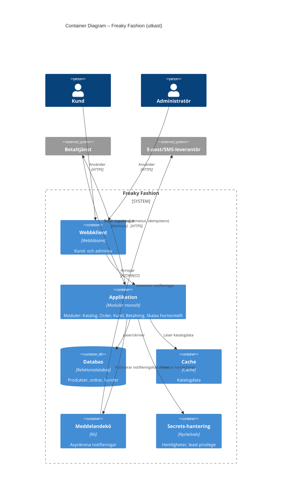

# Container Diagram (utkast)

Teknikneutralt utkast. Modulerna Katalog, Order, Kund och Betalning ligger inuti applikationen (se [ADR-001](../adr/001-modular-monolith.md)) och är inte egna containers.

## Containrar och ansvar

| Container | Ansvar |
|---|---|
| Webbklient | Kundens och adminens gränssnitt i webbläsaren |
| Applikation | All affärslogik, uppdelad i moduler. Skalas horisontellt |
| Databas | Persistent lagring av produkter, ordrar och kunder |
| Cache | Snabb läsning av katalogdata under hög last |
| Meddelandekö | Asynkron leverans av notifieringar |
| Secrets-hantering | Hemligheter utanför källkoden |
